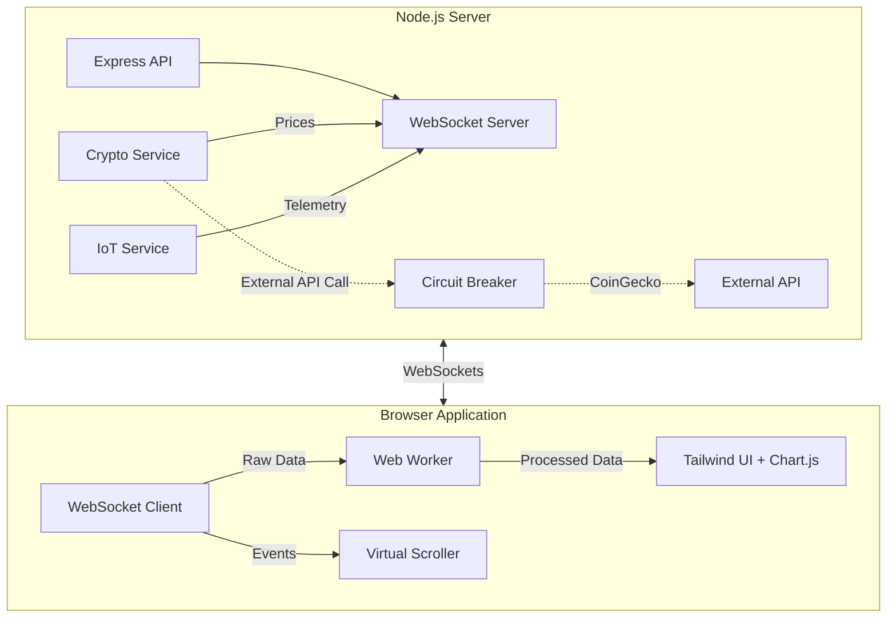

# 🌟 NexusDash: Real-Time Event-Driven Dashboard


NexusDash is a high-performance, real-time dashboard designed for rendering high-frequency streaming data from financial markets and IoT sensors. It emphasizes absolute UI smoothness via Web Workers and Virtual Scrolling, alongside robust backend architecture.

---

## ✨ Features

- **Real-Time WebSockets**: Instant bidirectional data streaming at massive scale.
- **Glassmorphic Dark Mode UI**: Breathtaking aesthetic powered by Tailwind CSS.
- **Virtual Scrolling**: Silky-smooth rendering of 100k+ event logs without DOM bloat.
- **Web Workers**: Offloads complex data transformations from the main thread, maintaining 60 FPS.
- **Circuit Breakers**: Graceful degradation when external upstream APIs fail.
- **Clean Architecture Backend**: Modular design prioritizing separation of concerns, easy testing, and scalability.

---

## 🛠️ Built With

* **Frontend**: Vanilla JavaScript (ES6+), HTML5, Tailwind CSS (via CDN)
* **Visuals**: Chart.js for responsive streaming charts
* **Backend**: Node.js, Express, `ws` for WebSockets
* **Architecture**: Clean Architecture, Error Middleware, Circuit Breakers

---

## 📐 Architecture Diagram



---

## 🤔 The "Why" & Trade-offs

### 1. **Why Tailwind CSS via CDN?**
* **Why**: For a quick, zero-build-step deployment that still offers utility-first flexibility to construct a beautiful glassmorphic dark mode UI.
* **Trade-off**: The CDN approach is slightly heavier on initial load compared to a compiled CSS bundle, but provides extreme agility for prototyping and refactoring.

### 2. **Why Web Workers for Data Processing?**
* **Why**: High-frequency WebSocket streams (like IoT ticks at 250ms) can stutter the main thread and drop frames. Moving parsing/transformation to a Worker guarantees UI fluidity.
* **Trade-off**: Increases architectural complexity and adds minor message-passing latency (typically <1ms).

### 3. **Why Virtual Scrolling?**
* **Why**: Attempting to render 100,000 DOM nodes crashes the browser. Virtual scrolling recycles a fixed pool of DOM elements based on scroll position.
* **Trade-off**: Requires manual computation of scroll offsets and heights instead of relying on native browser layout engines.

### 4. **Why Clean Architecture Backend?**
* **Why**: By separating concerns (Services, Routes, Middlewares), the application is highly testable and extensible. Incorporating Circuit Breakers ensures the dashboard doesn't crash when CoinGecko rate-limits the IP.
* **Trade-off**: More files and boilerplate than a single `server.js` monolith.

---

## 🚀 Quick Start

### Prerequisites
- Node.js v16+
- npm or yarn

### Installation

1. **Clone the repository** (if not already done):
   ```bash
   git clone https://github.com/your-username/realtime-dashboard.git
   cd realtime-dashboard
   ```

2. **Install dependencies**:
   ```bash
   npm install
   ```

3. **Start the server**:
   ```bash
   npm start
   ```
   *Alternatively, use `node server.js`*

4. **View the Dashboard**:
   Open your browser and navigate to `http://localhost:3000`.

---

## 📄 License
This project is licensed under the MIT License - see the LICENSE file for details.
