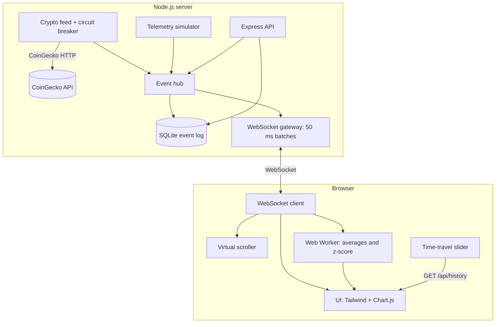

# NexusDash: Real-Time Event-Driven Dashboard


NexusDash is a real-time dashboard that streams events from a Node.js server to the browser over WebSockets.
It shows **real crypto prices from the CoinGecko public API** next to **simulated sensor telemetry**, keeps an
append-only event log in SQLite, and lets you rewind the event log with a time-travel slider.

> **About the data.** Crypto prices come from CoinGecko (or, if you choose so, from a demo generator).
> There is no physical sensor integration: the telemetry panel is always fed by a built-in simulator.
> Every event carries `source` and `isSimulated`, and the UI labels simulated data with a visible badge and banner.
> When CoinGecko is unreachable the dashboard shows "Unavailable" or "Stale". It never fills in placeholder prices.

## Features

- **WebSocket streaming** with 50 ms batching, ping/pong heartbeat, slow-consumer protection and Origin checks.
- **Crypto prices (real)**: BTC, ETH and SOL in USD from CoinGecko `/simple/price`, polled every 30 s by default. Each
  price shows the time CoinGecko reports for it. A circuit breaker with exponential backoff handles rate limits and outages.
- **Sensor telemetry (simulated)**: temperature, humidity and CPU from a bounded random walk with occasional spikes,
  so you can see the anomaly detector work. It is always labelled "Simulated data".
- **Edge analytics in a Web Worker**: moving averages and z-score anomaly detection run off the main thread.
- **Virtualised event log**: only visible rows exist in the DOM, so the log stays fast with up to 100k events in memory.
- **Event store**: every event is appended to SQLite (`node:sqlite`, no native addon) with time-based retention.
- **Time travel**: choose a minute in the last hour to replay that window from the event store, then go back to live.
- **Operations**: validated env config, structured JSON logs (pino), `/healthz` and `/readyz`, graceful shutdown,
  rate limiting, strict Content-Security-Policy, OpenAPI docs at `/api-docs`.

## Quick start

Requirements: **Node.js 22.13 or newer** (`node:sqlite` is used without flags) and npm.

```bash
git clone https://github.com/codebyjuliamendes/realtime-dashboard.git
cd realtime-dashboard
npm ci
npm run build   # compiles Tailwind CSS into public/css/app.css
npm start       # http://localhost:3001
```

- Dashboard: `http://localhost:3001`
- API docs (Swagger UI): `http://localhost:3001/api-docs`

For development, `npm run dev` builds the CSS and restarts the server when files change
(run `npm run build:watch` in another terminal if you are editing styles).

If your network cannot reach CoinGecko, run with `CRYPTO_SOURCE=demo` to get synthetic prices. They are labelled as
simulated and use deliberately unrealistic base values (100 / 50 / 10), so nobody mistakes them for market data.

### Docker

```bash
docker compose up --build      # http://localhost:3001, data kept in the "dashboard-data" volume
```

The image is a multi-stage `node:24-alpine` build. It runs as the non-root `node` user, has a `HEALTHCHECK` on
`/healthz` and stops cleanly on `SIGTERM`.

## Configuration

Every variable is optional. Invalid values stop the server at boot with a message that lists every problem.
See [`.env.example`](.env.example) for the full list.

| Variable                                     | Default                            | Description                                                                          |
| -------------------------------------------- | ---------------------------------- | ------------------------------------------------------------------------------------ |
| `PORT` / `HOST`                              | `3001` / `0.0.0.0`                 | HTTP and WebSocket listener                                                          |
| `LOG_LEVEL`                                  | `info`                             | pino level (`silent` in tests)                                                       |
| `DATA_DIR` / `DB_FILE`                       | `data` / `events.db`               | SQLite location (`DB_FILE=:memory:` for an ephemeral store)                          |
| `RETENTION_HOURS`                            | `24`                               | Events older than this are pruned every 10 min                                       |
| `CRYPTO_SOURCE`                              | `coingecko`                        | `coingecko` (real), `demo` (simulated, labelled) or `off`                            |
| `CRYPTO_POLL_MS`                             | `30000`                            | Poll interval. CoinGecko's public tier is rate limited, so keep it ≥ 10 s            |
| `COINGECKO_BASE_URL`                         | `https://api.coingecko.com/api/v3` | Override for a proxy or the Pro API                                                  |
| `COINGECKO_API_KEY`                          | _(empty)_                          | Optional CoinGecko demo key, sent as `x-cg-demo-api-key`                             |
| `UPSTREAM_TIMEOUT_MS`                        | `8000`                             | Timeout for CoinGecko requests                                                       |
| `IOT_SOURCE` / `IOT_INTERVAL_MS`             | `simulated` / `250`                | Telemetry simulator on or `off`                                                      |
| `WS_BATCH_MS` / `WS_HEARTBEAT_MS`            | `50` / `30000`                     | WebSocket batching and heartbeat                                                     |
| `ALLOWED_ORIGINS`                            | _(empty)_                          | Extra origins allowed for WebSocket and CORS. The same host is always allowed        |
| `HISTORY_BUFFER_SIZE`                        | `10000`                            | Events kept in memory for `/api/history?limit=`                                      |
| `HISTORY_MAX_LIMIT` / `HISTORY_MAX_RANGE_MS` | `5000` / `3600000`                 | Bounds for history queries                                                           |
| `RATE_LIMIT_PER_MINUTE`                      | `120`                              | Requests per IP per minute on `/api/*`                                               |
| `TRUST_PROXY`                                | `false`                            | Express `trust proxy`. Set to `1` behind one reverse proxy so client IPs are correct |
| `SHUTDOWN_TIMEOUT_MS`                        | `10000`                            | Maximum time to drain connections on shutdown                                        |

## Scripts

| Script                            | What it does                                            |
| --------------------------------- | ------------------------------------------------------- |
| `npm start`                       | Start the server                                        |
| `npm run dev`                     | Build CSS and start with `node --watch`                 |
| `npm run build` / `build:watch`   | Compile Tailwind CSS to `public/css/app.css`            |
| `npm test` / `test:coverage`      | Unit and integration tests (`node:test`)                |
| `npm run lint`                    | ESLint                                                  |
| `npm run format` / `format:check` | Prettier                                                |
| `npm run typecheck`               | TypeScript `checkJs` over the server code (JSDoc types) |
| `npm run check`                   | lint + format check + typecheck + tests                 |

## API

| Method | Path                           | Description                                                              |
| ------ | ------------------------------ | ------------------------------------------------------------------------ |
| GET    | `/api/history?limit=N`         | Most recent N events from memory (default 100)                           |
| GET    | `/api/history?start=ms&end=ms` | Events stored in SQLite between two epoch-ms timestamps, oldest first    |
| GET    | `/api/status`                  | Configured sources and feed health (state, last error, next retry)       |
| GET    | `/healthz` / `/readyz`         | Liveness and readiness probes                                            |
| WS     | `/`                            | `SYSTEM` greeting (with sources and latest price), then `BATCH` messages |

Event shape (illustrative values):

```json
{
  "type": "CRYPTO",
  "timestamp": 1793138890325,
  "source": "coingecko",
  "isSimulated": false,
  "data": { "bitcoin": { "usd": 64000.5, "last_updated_at": 1793138880 } }
}
```

Invalid parameters return `400` with `{ "status": "error", "message": "..." }`. The full spec is in
[`public/swagger.json`](public/swagger.json) (OpenAPI 3).

## Architecture



```
server.js               entry point: config, logger, signals, graceful shutdown
src/config.js           env parsing and validation (fails fast)
src/runtime.js          composition root: wires store, feeds, HTTP, WebSocket; start/stop
src/domain/             pure logic: circuit breaker, ring buffer, CoinGecko parsing, simulators, query validation
src/infra/              SQLite event store, CoinGecko HTTP client
src/services/           event hub, crypto feed, telemetry feed, WebSocket gateway
src/http/               Express app (security headers, rate limit, static assets), routes, error handler
public/                 dashboard (ES modules, no build step except Tailwind), worker, API docs page
test/unit, test/integration
```

### Design decisions and trade-offs

- **Honest data over a pretty fallback.** Earlier versions filled in random prices when CoinGecko failed. Now a
  failure produces a `SYSTEM_ERROR` event, the UI keeps the last real price marked as stale, and synthetic data
  exists only in the explicit, labelled `demo` mode.
- **Only publish new prices.** CoinGecko updates roughly once a minute, so the feed publishes a `CRYPTO` event only
  when the data changes. The event log and the chart then show real updates, not repeated polls.
- **Self-hosted front-end assets with a strict CSP.** Tailwind is compiled at build time, and Chart.js and Swagger UI
  are served from `node_modules`. This allows `script-src 'self'` without `unsafe-inline`, and the page makes no
  third-party requests.
- **`node:sqlite`.** No native module to compile, and it is enough for a single-node append-only log. The trade-off is
  that the feature is still marked experimental by Node.js (a warning is printed at boot).
- **Crypto chart in % change.** BTC, ETH and SOL prices differ by orders of magnitude. Plotting the % change since
  the start of the window keeps all three readable, and the tooltip shows the actual price.
- **Web Worker and virtual scrolling** keep the main thread free at the 4+ events/s telemetry rate.

## Testing

```bash
npm run check
```

- Unit tests cover the domain logic (circuit breaker, ring buffer, CoinGecko parsing, simulators, history query
  validation, config) and the browser modules that have no DOM dependency (statistics, formatting, source-state logic).
- Integration tests start the real server on an ephemeral port with an in-memory database and a stubbed CoinGecko
  client. They cover HTTP endpoints, validation, the CSP, rate limiting, WebSocket greeting and batching, Origin
  rejection, "no placeholder prices on failure" and graceful shutdown. They make no network calls.
- CI (GitHub Actions) runs lint, format, typecheck, build and tests on Node 22 and 24. It then builds the Docker
  image and smoke-tests it: health, assets, API and graceful shutdown.

## Deployment

- **Docker / Compose**: see above. Mount a volume at `/app/data` to keep the event log.
- **Kubernetes**: `kubectl apply -f k8s/` creates a Deployment (1 replica, non-root, read-only root filesystem,
  startup, readiness and liveness probes), a PVC for the SQLite file, a ClusterIP Service and an NGINX Ingress with
  WebSocket-friendly timeouts. Build and push the image, then set `image:` in `k8s/deployment.yaml`.
- Behind a reverse proxy, set `TRUST_PROXY=1` so rate limiting uses the real client IP. Add the public origin to
  `ALLOWED_ORIGINS` if the dashboard is served from a different host than the WebSocket.

## Limitations

- **Single instance.** The event log is a local SQLite file and the live buffer is in memory. Running several
  replicas would give each one a different history. Scaling out would need a shared store and pub/sub (for example
  Postgres or Redis).
- **CoinGecko public API.** It is rate limited and only refreshes about once a minute, so this is not a tick-level
  market feed. Respect CoinGecko's terms of use and attribution (the footer links to CoinGecko).
- **Telemetry is simulated.** No device protocol (MQTT or similar) is implemented.
- **No authentication.** All data is read-only and public. Put the app behind your own auth or proxy if needed.
- The dashboard has a dark theme only.

## License

[MIT](LICENSE) © Júlia Mendes
